# Інструкція Користувача додатка — TTA

- **Посилання на додаток:** https://tta-frontend.vercel.app
- **Дата редакції:** 22.11.2026

---

## Зміст

1. [Вітальне вікно додатка — TTA](#1-вітальне-вікно-додатка--tta)
2. [Реєстрація нового Користувача або вхід у додаток для наявного](#2-реєстрація-нового-користувача-або-вхід-у-додаток-для-наявного)
3. [Головне вікно додатка (`TTA Hub Navigation`)](#3-головне-вікно-додатка-tta-hub-navigation)
4. [Турніри (`Tournaments Feature`)](#4-турніри-tournaments-feature)
5. [Матчі, що відстежуються Користувачем (`My Tracked Matches`)](#5-матчі-що-відстежуються-користувачем-my-tracked-matches)
6. [Налаштування матчу (`Match Setup Wizard`)](#6-налаштування-матчу-match-setup-wizard)
   - [6.1. Додавання Користувачем позитивних ТТД для відстеження](#61-додавання-користувачем-позитивних-ттд-для-відстеження)
   - [6.2. Додавання Користувачем негативних ТТД для відстеження](#62-додавання-користувачем-негативних-ттд-для-відстеження)
   - [6.3. Підтвердження налаштувань відстеження ТТД гравців під час матчу](#63-підтвердження-налаштувань-відстеження-ттд-гравців-під-час-матчу)
7. [Консоль запису матчу (`TTA Match Recorder`)](#7-консоль-запису-матчу-tta-match-recorder)
   - [7.1. Початок періоду (вибір стартового складу)](#71-початок-періоду-вибір-стартового-складу)
   - [7.2. Заміни під час матчу](#72-заміни-під-час-матчу)
   - [7.3. Фіксація техніко-тактичних дій гравців під час гри](#73-фіксація-техніко-тактичних-дій-гравців-під-час-гри)
   - [7.4. Облік персональних фолів, автоматичний вихід та гра в меншості (`Shorthanded`)](#74-облік-персональних-фолів-автоматичний-вихід-та-гра-в-меншості-shorthanded)
   - [7.5. Зупинка та відновлення ігрового часу](#75-зупинка-та-відновлення-ігрового-часу)
   - [7.6. Редагування та видалення внесених ТТД у секторі `LAST ACTIONS`](#76-редагування-та-видалення-внесених-ттд-у-секторі-last-actions)
   - [7.7. Завершення періоду та скасування завершення періоду](#77-завершення-періоду-та-скасування-завершення-періоду)
   - [7.8. Перенесення штрафів між періодами та кнопка `Reset`](#78-перенесення-штрафів-між-періодами-та-кнопка-reset)
   - [7.9. Дострокове завершення та закінчення матчу](#79-дострокове-завершення-та-закінчення-матчу)
   - [7.10. Остаточне оформлення результату матчу (`Match Result Finalization`)](#710-остаточне-оформлення-результату-матчу-match-result-finalization)
8. [Отримання звітів про ТТД гравців під час матчу](#8-отримання-звітів-про-ттд-гравців-під-час-матчу)
   - [8.1. Текстові звіти про ТТД гравців під час матчу](#81-текстові-звіти-про-ттд-гравців-під-час-матчу)
   - [8.2. Візуалізація звіту про ТТД гравців команди з використанням схеми ігрового поля та воріт](#82-візуалізація-звіту-про-ттд-гравців-команди-з-використанням-схеми-ігрового-поля-та-воріт)
9. [Неочікуваний збій під час відстеження матчу](#9-неочікуваний-збій-під-час-відстеження-матчу)
- [Додаток A. Позитивні ТТД (Водне поло)](#додаток-a-позитивні-ттд-водне-поло)
- [Додаток B. Негативні ТТД (Водне поло)](#додаток-b-негативні-ттд-водне-поло)

---

## 1. Вітальне вікно додатка — TTA

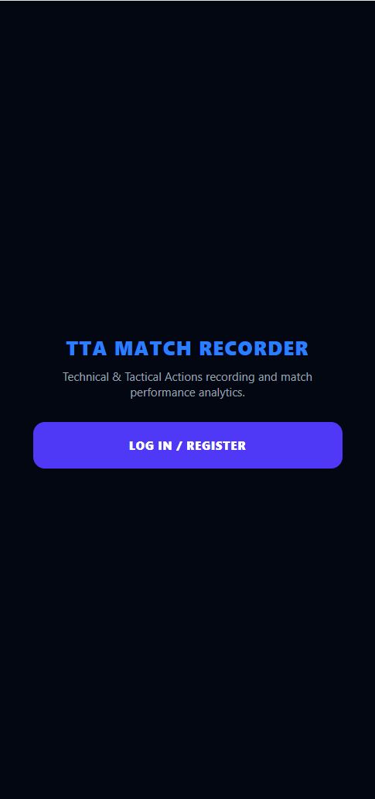

Для початку роботи з додатком натисніть кнопку **`Log In / Register`**.

---

## 2. Реєстрація нового Користувача або вхід у додаток для наявного

### 2.1. Вхід наявного / Реєстрація нового Користувача

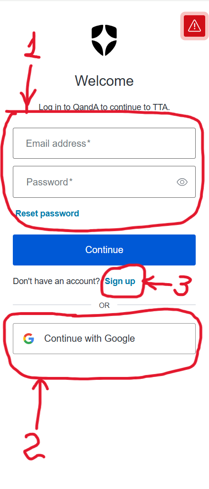

- **1** — вхід для наявного Користувача з використанням електронної пошти, вказаної під час реєстрації;
- **2** — вхід через обліковий запис Gmail (Google);
- **3** — перехід до реєстрації нового Користувача (`Sign up`).

### 2.2. Вхід наявного Користувача

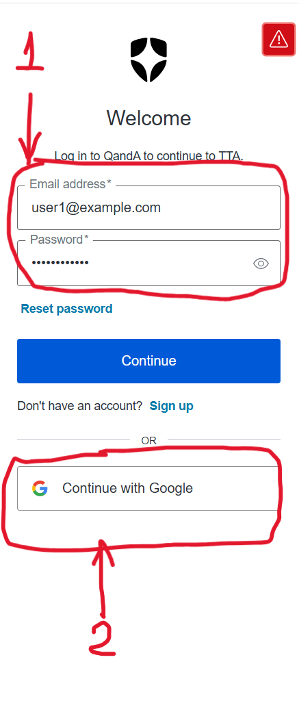

- **1** — вхід для наявного Користувача з використанням електронної пошти та пароля, вказаних під час реєстрації;
- **2** — вхід через Gmail.

### 2.3. Реєстрація нового Користувача

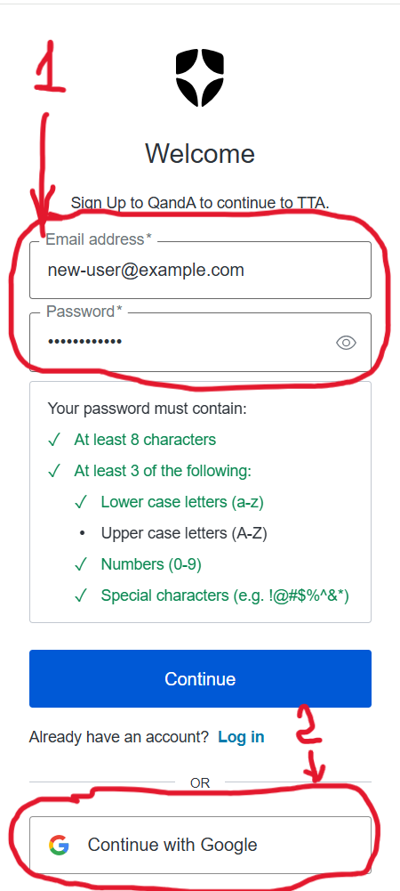

- **1** — реєстрація нового Користувача з використанням електронної пошти та пароля;
- **2** — реєстрація нового Користувача через Gmail.

---

## 3. Головне вікно додатка (`TTA Hub Navigation`)

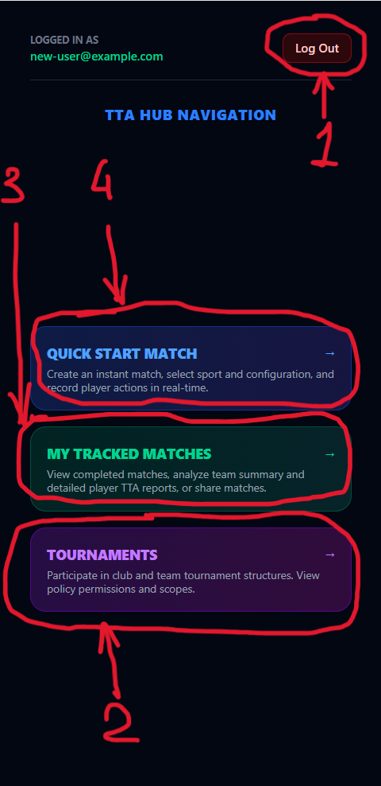

- **1** — вихід зі свого облікового запису в додатку (кнопка **`Log Out`**);
- **2** — перехід до розділу **`TOURNAMENTS FEATURE`** (картка **`Tournaments`**);
- **3** — перехід до розділу **`MY TRACKED MATCHES`** (картка **`My Tracked Matches`** — у цьому розділі містяться всі завершені матчі, які відстежувалися Користувачем, або ті, до яких йому надано доступ);
- **4** — перехід до розділу **`MATCH SETUP WIZARD`** (картка **`Quick Start Match`** — запуск налаштування та запису техніко-тактичних дій під час матчу).

---

## 4. Турніри (`Tournaments Feature`)

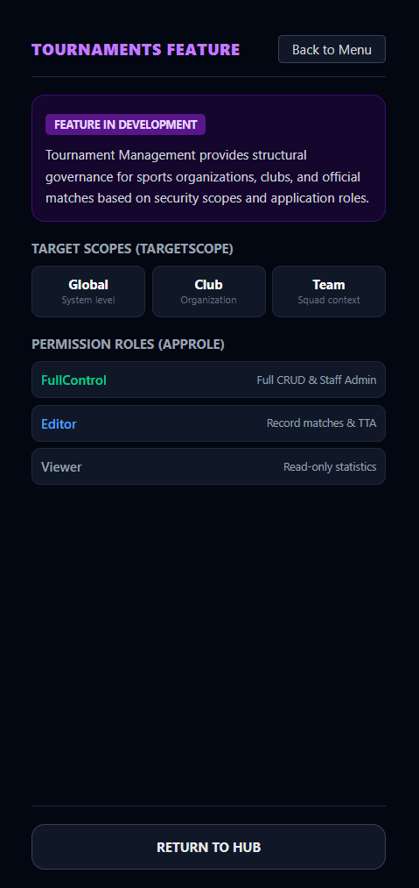

Наразі розділ перебуває в розробці (`Feature in Development`).
Цей розділ призначений для створення клубів, команд у їхньому складі та офіційних турнірів, а також для управління ролями доступу (`FullControl`, `Editor`, `Viewer`) на рівнях системи (`Global`), клубу (`Club`) та команди (`Team`).
Для повернення до головного меню натисніть **`Back to Menu`** або **`Return to Hub`**.

---

## 5. Матчі, що відстежуються Користувачем (`My Tracked Matches`)

### 5.1. Вигляд на початку, коли ще немає відстежуваних матчів

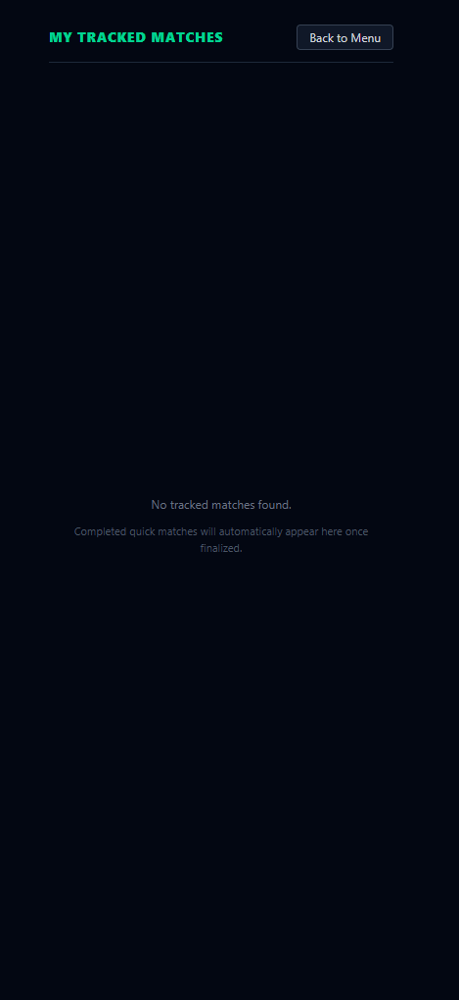

Коли Користувач ще не завершив жодного матчу, на екрані відображається повідомлення `No tracked matches found.`. Завершені матчі автоматично з'являються в цьому списку після фіналізації результату.

### 5.2. Перегляд наявних звітів відстежуваних матчів

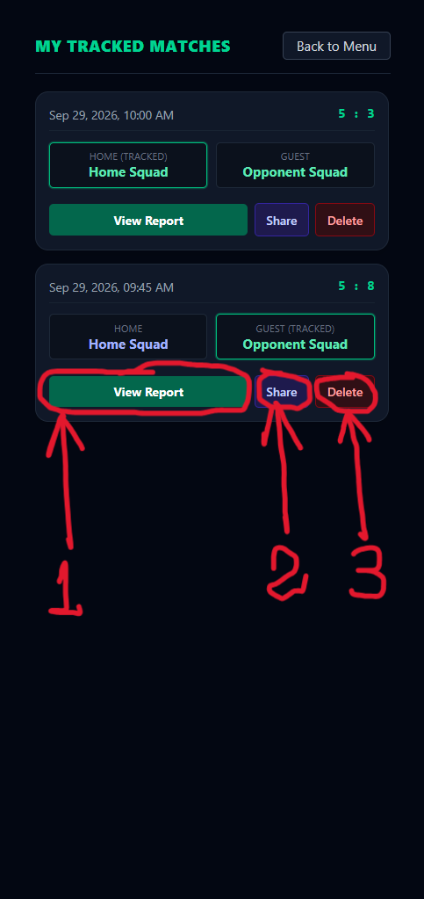

На кожній картці завершеного матчу відображаються дата й час, підсумковий рахунок, назви команд господарів (`Home`) і гостей (`Guest`) із позначкою **`(Tracked)`** біля команди, за якою велося спостереження, а також кнопки керування:

- **1** — перехід до перегляду звіту матчу (кнопка **`View Report`**);
- **2** — поділитися звітом матчу з іншим Користувачем за його електронною поштою (кнопка **`Share`**, що відкриває вікно `Share Match with User`);
- **3** — видалити матч зі свого списку відстежуваних (кнопка **`Delete`**). Якщо для цього матчу на пристрої є активна незавершена чернетка, додаток захистить її від випадкового видалення та попросить спершу завершити або скасувати чернетку.

> **Примітка:** Детальний опис роботи зі звітами наведено в розділі **[8. Отримання звітів про ТТД гравців під час матчу](#8-отримання-звітів-про-ттд-гравців-під-час-матчу)**.

---

## 6. Налаштування матчу (`Match Setup Wizard`)

Форма **`MATCH SETUP WIZARD`** використовується для налаштування параметрів матчу та вибору техніко-тактичних дій (ТТД) гравців, які відстежуватимуться під час гри.

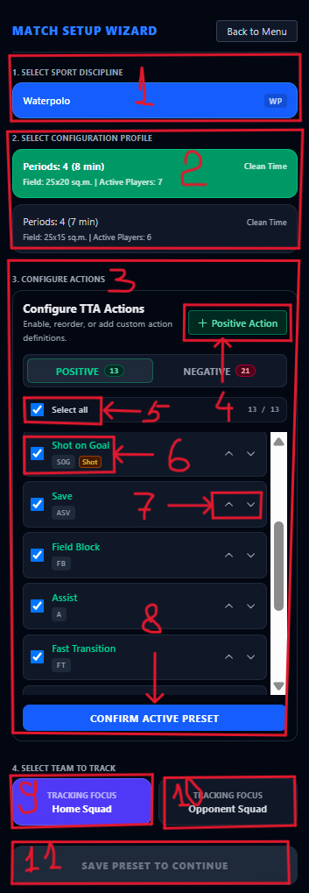

- **1** — вибір виду спорту (`1. Select Sport Discipline`, наразі доступне Водне поло — **`Waterpolo` / `WP`**);
- **2** — вибір конфігурації гри (`2. Select Configuration Profile`): кількість і тривалість періодів, чистий або брудний час (`Clean Time` / `Running Time`), розміри поля (`25x20 sq.m.` або `25x15 sq.m.`) та кількість активних гравців у воді (`Active Players: 7` або `6`);
- **3** — розділ налаштування визначень ТТД (`3. Configure Actions` / **`Configure TTA Actions`**), які відстежуватимуться під час матчу;
- **4** — кнопка додавання власних визначень ТТД (**`+ Positive Action`** або **`+ Negative Action`** залежно від обраної вкладки; див. пункти [6.1](#61-додавання-користувачем-позитивних-ттд-для-відстеження) та [6.2](#62-додавання-користувачем-негативних-ттд-для-відстеження));
- **5** — чекбокс **`Select all`** для вибору або зняття одразу всіх визначень подій у поточній вкладці (`POSITIVE` або `NEGATIVE`) із лічильником обраних дій праворуч (наприклад, `13 / 13` або `21 / 21`);
- **6** — індивідуальний чекбокс визначення ТТД: щоб вибрати дію для відстеження, установіть позначку поруч із нею (якщо позначка відсутня, ця ТТД під час матчу не відображатиметься);
- **7** — кнопки зі стрілками вгору/вниз (`Move Up` / `Move Down`) навпроти кожного визначення ТТД, за допомогою яких можна встановити зручний порядок відображення кнопок ТТД під час гри;
- **8** — кнопка **`CONFIRM ACTIVE PRESET`** для збереження та підтвердження обраного набору ТТД. Якщо не обрано жодного визначення ТТД, за замовчуванням використовуватимуться всі стандартні визначення ТТД, які надає додаток (**13 позитивних та 21 негативна ТТД**, див. [Додаток A](#додаток-a-позитивні-ттд-водне-поло) та [Додаток B](#додаток-b-негативні-ттд-водне-поло)). Без натискання кнопки **8** нижня кнопка запуску матчу (**11**) залишатиметься неактивною;
- **9** — вибір команди господарів (**`Tracking Focus: Home Squad`** — білі шапочки);
- **10** — вибір команди суперника/гостей (**`Tracking Focus: Opponent Squad`** — сині шапочки);
- **11** — кнопка запуску відстеження матчу (поки пресет не підтверджено кнопкою **8**, кнопка неактивна і має напис **`SAVE PRESET TO CONTINUE`**; після підтвердження пресету вона стає зеленою з написом **`START TRACKING MATCH`**).

---

### 6.1. Додавання Користувачем позитивних ТТД для відстеження

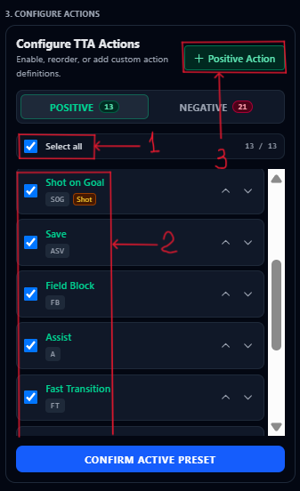

Виберіть вкладку **`POSITIVE`**, щоб переглянути список запропонованих позитивних визначень ТТД:

- **1** — чекбокс **`Select all`** для обрання одразу всіх позитивних визначень ТТД;
- **2** — позначки навпроти тих визначень ТТД, за якими ви бажаєте стежити під час матчу;
- **3** — натисніть кнопку **`+ Positive Action`** для створення власної позитивної ТТД.

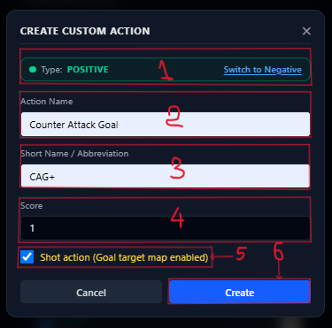

У вікні **`Create Custom Action`** заповніть параметри нової дії:

- **1** — якщо ви помилилися у виборі категорії ТТД, натисніть **`Switch to Negative`**, щоб перемкнути тип на негативну дію;
- **2** — поле **`Action Name`** для повної назви події ТТД (наприклад, `Counter Attack Goal`);
- **3** — поле **`Short Name / Abbreviation`** для короткої абревіатури дії (до 5 символів, наприклад, `CAG`);
- **4** — числове поле **`Score`** (кількість очок/голів від `0` до `10`, за замовчуванням `0`): укажіть `1` (або більше), якщо ця дія змінює рахунок матчу, або залиште `0` для звичайної ігрової дії;
- **5** — чекбокс **`Shot action (Goal target map enabled)`**: установіть позначку, якщо подія є кидком по воротах (для неї під час матчу відкриватиметься карта воріт `SHOTS`);
- **6** — натисніть кнопку **`Create`** для збереження (або `Cancel` для скасування).

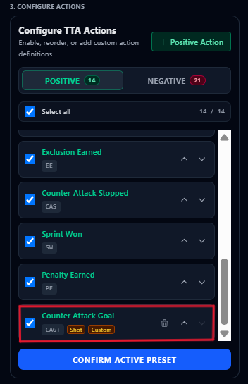

Щойно створена позитивна ТТД з'явиться внизу списку позитивних дій із позначкою **`Custom`** (та позначкою **`Shot`**, якщо було увімкнено чекбокс кидка). За потреби користувацьку дію можна видалити натисканням на іконку кошика праворуч.

---

### 6.2. Додавання Користувачем негативних ТТД для відстеження

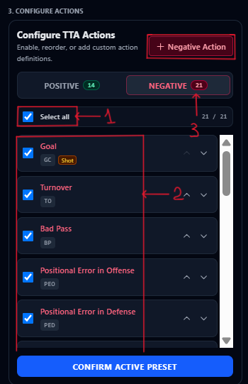

Виберіть вкладку **`NEGATIVE`**, щоб переглянути список запропонованих негативних визначень ТТД:

- **1** — чекбокс **`Select all`** для обрання одразу всіх негативних визначень ТТД;
- **2** — позначки навпроти тих визначень ТТД, за якими ви бажаєте стежити під час матчу;
- **3** — натисніть кнопку **`+ Negative Action`** для створення власної негативної ТТД.

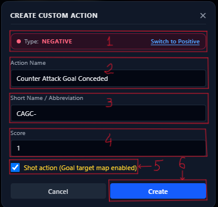

У вікні **`Create Custom Action`** заповніть параметри нової негативної дії:

- **1** — якщо ви помилилися у виборі категорії ТТД, натисніть **`Switch to Positive`**, щоб перемкнути тип на позитивну дію;
- **2** — поле **`Action Name`** для повної назви події ТТД;
- **3** — поле **`Short Name / Abbreviation`** для короткої абревіатури дії (до 5 символів);
- **4** — числове поле **`Score`** (кількість очок/голів від `0` до `10`, за замовчуванням `0`; для негативних результативних дій очки зараховуються на користь команди-суперника);
- **5** — чекбокс **`Shot action (Goal target map enabled)`**: установіть позначку, якщо подія є кидком по воротах;
- **6** — натисніть кнопку **`Create`** для збереження (або `Cancel` для скасування).

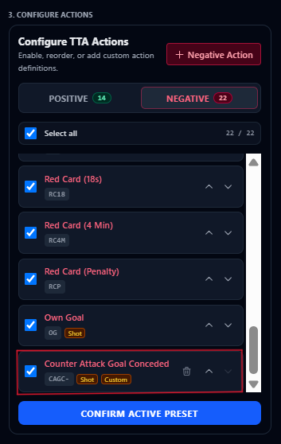

Щойно створена негативна ТТД з'явиться внизу списку негативних дій із позначкою **`Custom`**.

---

### 6.3. Підтвердження налаштувань відстеження ТТД гравців під час матчу

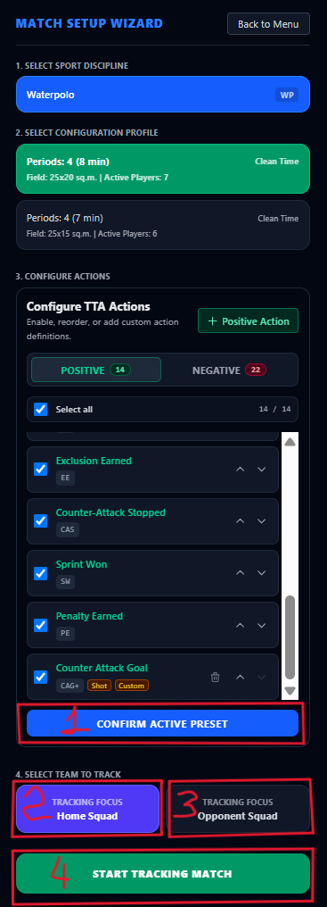

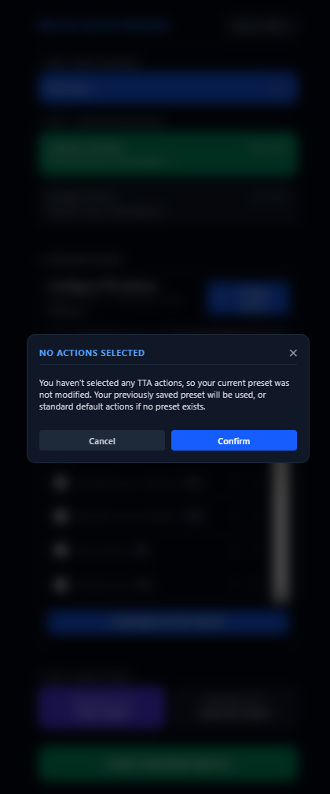

- **1** — Користувач повинен підтвердити вибрані показники відстеження матчу, натиснувши кнопку **`CONFIRM ACTIVE PRESET`**; після цього нижня кнопка форми (**4**) змінить напис із `SAVE PRESET TO CONTINUE` на **`START TRACKING MATCH`**, стане активною та набуде зеленого кольору;
- **2, 3** — вибір команди, чиї техніко-тактичні дії (ТТД) Користувач бажає відстежувати:
  - **2** — **`Home Squad`** (команда господарів, білі шапочки);
  - **3** — **`Opponent Squad`** (команда суперника/гостей, сині шапочки);
- **4** — натискання кнопки **`START TRACKING MATCH`** запускає консоль відстеження матчу.

> ⚠️ **УВАГА!**
> Якщо не вибрано жодної ТТД (`0` позитивних та `0` негативних), то після натискання кнопки **`CONFIRM ACTIVE PRESET`** з'явиться діалогове вікно **`No Actions Selected`**. Натискання кнопки **`Cancel`** поверне Користувача до форми `Match Setup Wizard`, а натискання кнопки **`Confirm`** означатиме, що використовуватиметься попередньо збережений пресет або всі стандартні ТТД за замовчуванням (**13 позитивних і 21 негативна ТТД**, див. [Додаток A](#додаток-a-позитивні-ттд-водне-поло) та [Додаток B](#додаток-b-негативні-ттд-водне-поло)).

---

## 7. Консоль запису матчу (`TTA Match Recorder`)

Форма **`TTA MATCH RECORDER`** — це головна робоча панель для керування періодами, складом гравців у воді та фіксації ТТД у реальному часі.
У правому верхньому куті шапки консолі розташований індикатор мережі та синхронізації:
- **`Online`** (зелений індикатор) або **`Offline`** (червоний індикатор);
- якщо є події, що очікують відправки на сервер, поруч відображається бейдж **`N pending`** (натискання на індикатор у режимі `Online` запускає негайну синхронізацію черги).

---

### 7.1. Початок періоду (вибір стартового складу)

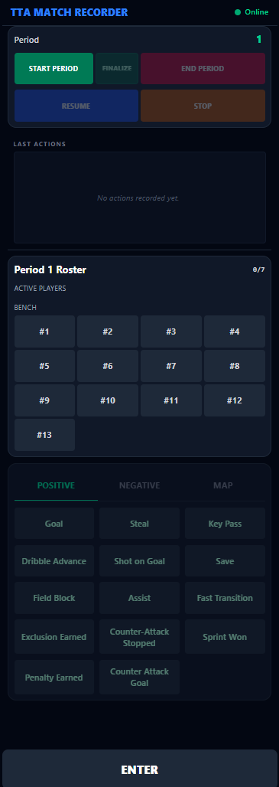

- Початковий стан консолі одразу після запуску матчу: усі гравці перебувають у секторі **`Bench`** (лава запасних), а праворуч від заголовка **`Period 1 Roster`** відображається лічильник стартового складу **`0/7`** (для стандартної конфігурації водного поло з 7 активними гравцями).

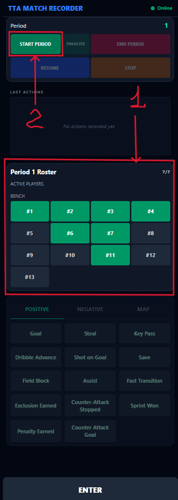

- **1** — оберіть у секторі **`Bench`** необхідну кількість гравців, які розпочнуть період (обрані плитки підсвічуються зеленим кольором, а лічильник праворуч від `Period 1 Roster` зміниться на **`7/7`**);
- **2** — натисніть кнопку **`START PERIOD`**, щоб розпочати період.

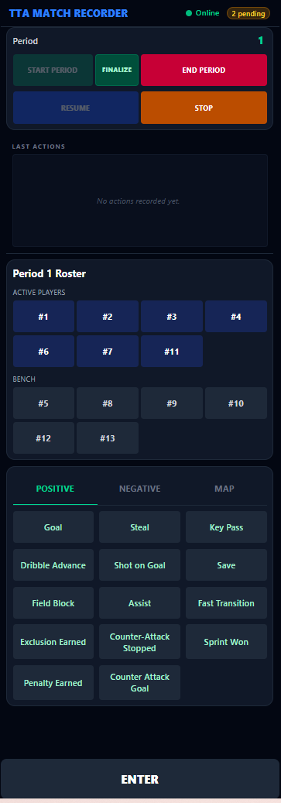

- Після натискання **`START PERIOD`** обрані 7 гравців переміщуються до сектора **`Active Players`** (гравці у воді), а кнопки керування періодом **`END PERIOD`** і **`STOP`** та панель фіксації ТТД стають активними.

---

### 7.2. Заміни під час матчу

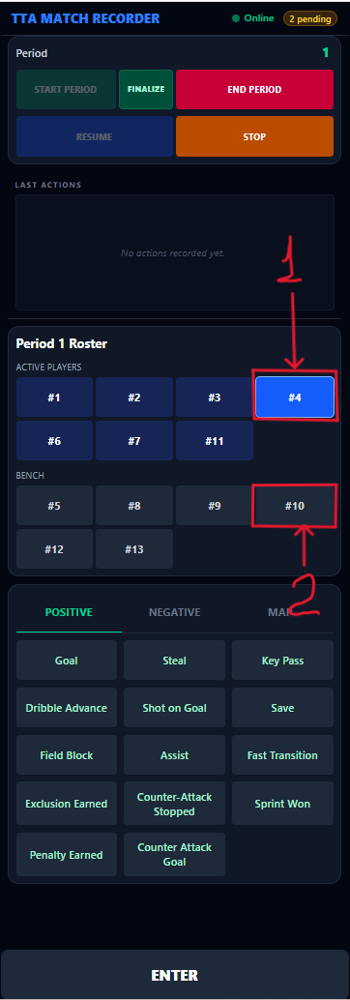

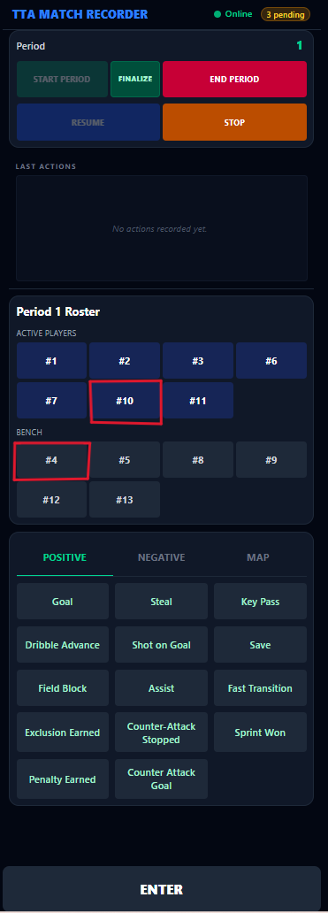

Для проведення рівноцінної заміни під час активного періоду:

- **1** — виберіть гравця, який перебуває у воді (сектор **`Active Players`**), якого потрібно замінити (плитка виділиться яскраво-синім кольором);
- **2** — натисніть на номер гравця на лаві запасних (сектор **`Bench`**), який виходить у воду.

Після цього гравці миттєво міняються місцями (час виходу першого та час входу другого гравця фіксуються автоматично).

---

### 7.3. Фіксація техніко-тактичних дій гравців під час гри

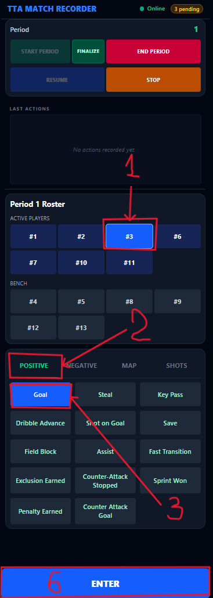

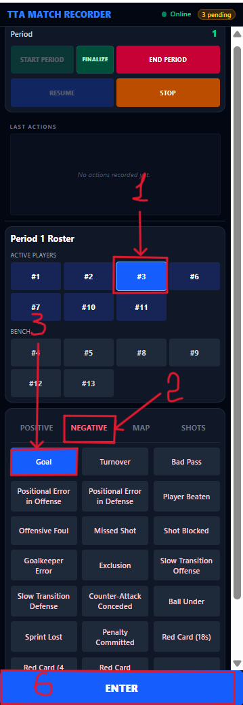

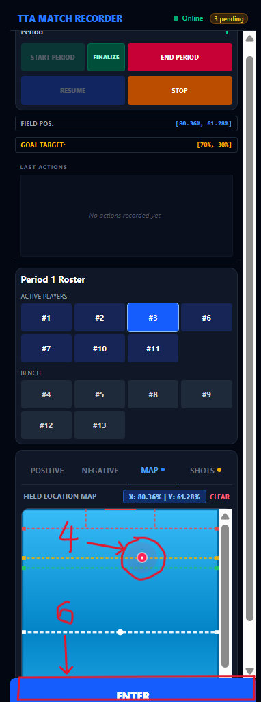

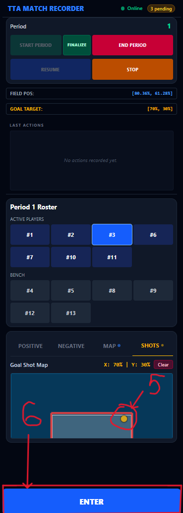

Порядок фіксації ігрової події (ТТД):

- **1** — виберіть активного гравця в секторі **`Active Players`**;
- **2** — виберіть вкладку **`POSITIVE`** (позитивні дії) або **`NEGATIVE`** (негативні дії);
- **3** — натисніть на кнопку відповідного визначення ТТД у списку вкладки `POSITIVE` або `NEGATIVE`;
- **4** — за бажанням перейдіть на вкладку **`MAP`** (`Field Location Map`) та позначте на схемі поля точку, де відбулася подія (над списком останніх дій з'явиться плашка **`FIELD POS: [X%, Y%]`**, а на вкладці `MAP` — синій індикатор; скинути точку можна кнопкою `Clear`);
- **5** — у разі обрання ТТД, пов'язаної з кидком по воротах (`Goal`, `Shot on Goal`, `Missed Shot`, `Own Goal` або користувацької дії з позначкою `Shot`), автоматично з'явиться 4-та вкладка **`SHOTS`** (`Goal Shot Map`), на якій можна позначити точку влучання відносно каркаса воріт (з'явиться плашка **`GOAL TARGET: [X%, Y%]`** та бурштиновий індикатор на вкладці `SHOTS`);
- **6** — натисніть кнопку **`ENTER`** унизу екрана для збереження дії.

---

### 7.4. Облік персональних фолів, автоматичний вихід та гра в меншості (`Shorthanded`)

Додаток автоматично відстежує персональні фоли, тимчасові вилучення та дискваліфікації гравців згідно з правилами водного поло (ліміт персональних фолів — `3`).

#### Дисциплінарні бейджі на плитках гравців та авто-вихід на лаву запасних

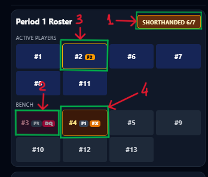

- **1** — індикатор-кнопка гри в меншості **`Shorthanded 6/7`** праворуч від заголовка `Period N Roster`: з'являється автоматично, коли кількість активних гравців у воді стає меншою за дозволений ліміт (7 гравців);
- **2** — плитка гравця на лаві запасних (`Bench`) із тимчасовим вилученням: має бейдж кількості персональних фолів (`F1`, `F2`) та бурштиновий бейдж **`EX`** (активне тимчасове вилучення). При фіксації дії з тимчасовим вилученням (**`Exclusion` / `E`** на 18 с, **`Red Card (18s)` / `RC18`** на 18 с або **`Red Card (4 Min)` / `RC4M`** на 4 хв) додаток **автоматично переводить гравця з `Active Players` на `Bench`**;
- **3** — попереджувальний бурштиновий бейдж **`F2`** та бурштинова рамка плитки: сигналізують, що гравець має 2 персональні фоли (один фол до дискваліфікації). Персональні фоли нараховуються за дії **`Exclusion` (`E`)** та **`Penalty Committed` (`PC`)** (при цьому `PC` додає фол `F1`/`F2`, але залишає гравця у воді, якщо це не 3-й фол);
- **4** — заблокована плитка дискваліфікованого гравця з червоним бейджем **`DQ`** (наприклад, `F3 DQ` після 3-го персонального фолу або `DQ` після отримання червоної картки). Гравець із бейджем `DQ` автоматично переводиться на `Bench` і **не може повернутися у воду до кінця матчу**.

#### Семантика трьох видів червоних карток у водному поло (`RC18`, `RC4M`, `RCP`)
У водному поло всі три визначення червоних карток дискваліфікують вилученого гравця до кінця матчу (`DQ`), але **ніколи не зменшують максимальний ліміт активних гравців команди (7) на залишок матчу** — інший гравець із лави запасних завжди має право вийти на заміну:
- **`Red Card (18s)` (`RC18`)** — гравець отримує `DQ` до кінця матчу та автоматично переходить на `Bench`, а команда грає в меншості протягом **18 секунд** (`EX`), після чого на поле може вийти інший партнер по команді.
- **`Red Card (4 Min)` (`RC4M`)** — гравець отримує `DQ` до кінця матчу та автоматично переходить на `Bench`, а команда грає в меншості протягом **4 хвилин / 240 секунд** (`EX`), після чого у воду також виходить інший гравець із лави запасних.
- **`Red Card (Penalty)` (`RCP`)** — гравець отримує `DQ` до кінця матчу з призначенням пенальті та автоматично переходить на `Bench` без таймера командного вилучення в додатку (іншого гравця з лави запасних можна випустити у воду одразу через кнопку `Shorthanded`, не чекаючи завершення штрафного часу).

> **Примітка:** Залежно від рішення арбітра в реальній ігровій ситуації, червона картка у водному поло може супроводжуватися призначенням пенальті та/або тимчасовим командним вилученням на 18 секунд чи 4 хвилини — обирайте відповідну дію (`RC18`, `RC4M` або `RCP`).

#### Повернення гравця у воду після завершення штрафу (режим `Shorthanded`)

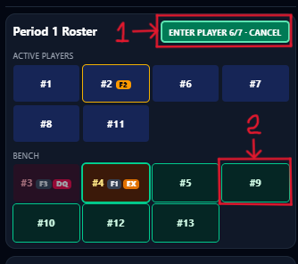

Коли час вилучення сплив і команда має право відновити повний склад у воді (без заміни іншого активного гравця), виконайте два кроки:

- **1** — натисніть бурштинову кнопку **`Shorthanded 6/7`** у заголовку ростера: вона стане зеленою та змінить напис на **`Enter Player 6/7 · Cancel`** (повторне натискання на неї скасовує режим входу);
- **2** — натисніть на плитку потрібного гравця в секторі **`Bench`** (доступні для виходу гравці підсвічені зеленою рамкою): обраний гравець одразу перейде до сектора **`Active Players`**, бейдж `EX` зніметься, а склад команди у воді відновиться до `7` гравців.

---

### 7.5. Зупинка та відновлення ігрового часу

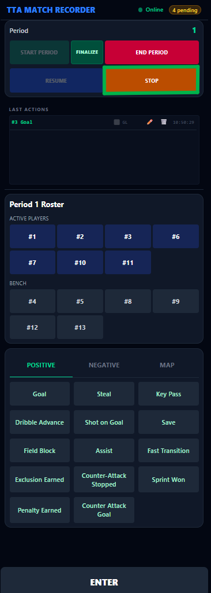

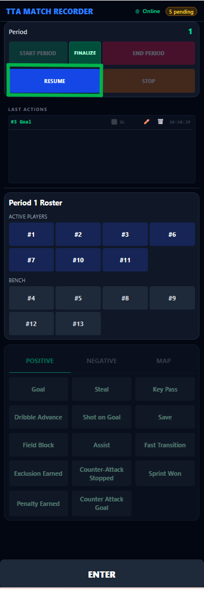

- Щоб тимчасово зупинити ігровий час (під час паузи або тайм-ауту), натисніть кнопку **`STOP`** (під час зупинки часу фіксація ТТД та кнопка `END PERIOD` тимчасово блокуються).
- Щоб відновити відлік ігрового часу, натисніть кнопку **`RESUME`**.

---

### 7.6. Редагування та видалення внесених ТТД у секторі `LAST ACTIONS`

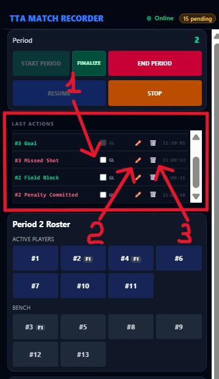

У секторі **`LAST ACTIONS`** відображається журнал останніх записаних подій поточного матчу:

- **1** — чекбокс **`GL`** (`Goal Lead`): установіть позначку, щоб відмітити, що ця дія (позитивна чи негативна) безпосередньо призвела до взяття воріт (для самих голів та інших результативних дій зі `Score > 0` чекбокс `GL` автоматично неактивний);
- **2** — кнопка **`✏️`** (`Edit Action`): відкриває діалогове вікно редагування обраної ТТД;
- **3** — кнопка **`🗑️`** (`Delete Action`): відкриває діалогове вікно підтвердження видалення події (`Cancel` / `Delete`).

> 🔒 **Особливості синхронізації та автоматичного повернення гравців:**
> - Поки подія ще не відправлена на сервер, її можна вільно редагувати або видаляти. Якщо ви видалите або зміните несинхронізовану дисциплінарну подію (наприклад, випадково записане вилучення `E` або червону картку), через яку гравець автоматично перейшов на `Bench`, додаток **автоматично поверне цього гравця назад у сектор `Active Players`** і перерахує його фоли.
> - Щойно подію синхронізовано з сервером, поруч із нею з'являється жовта іконка замка **`🔒`** (`Synchronized event`), після чого редагування, зміна прапорця `GL` та видалення цієї події блокуються.

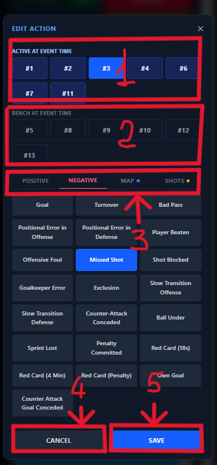

У діалоговому вікні **`Edit Action`** усі гравці команди автоматично групуються за їхнім фактичним місцезнаходженням у секунду скоєння події:

- **1** — секція **`Active at Event Time`** (сині плитки): гравці, які перебували у воді безпосередньо в момент фіксації цієї події;
- **2** — секція **`Bench at Event Time`** (сірі плитки): гравці, які в момент події перебували на лаві запасних;
- **3** — вкладки **`POSITIVE`**, **`NEGATIVE`**, **`MAP`** та (якщо обрано дію-кидок) **`SHOTS`** для зміни типу ТТД, координат події на полі або точки кидка у воротах;
- **4** — кнопка **`Cancel`** для скасування змін;
- **5** — кнопка **`Save`** для збереження відредагованої ТТД.

---

### 7.7. Завершення періоду та скасування завершення періоду

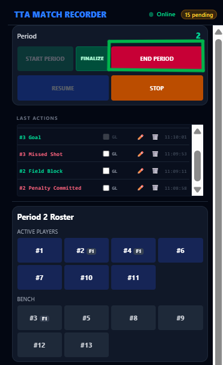

- Щоб завершити поточний активний період, натисніть червону кнопку **`END PERIOD`** (кнопка доступна, коли ігровий час не перебуває на паузі `STOP`). Усі активні гравці автоматично переводяться на лаву запасних (`Bench`) для вибору стартового складу на наступний період.

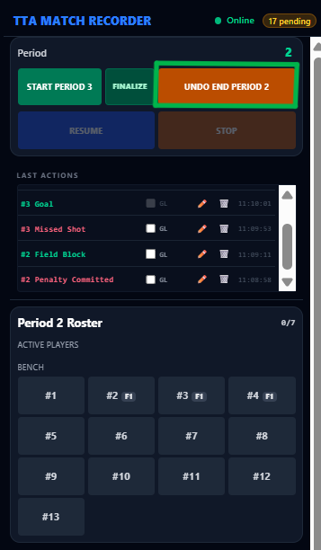

- **1** — якщо ви випадково завершили період, натисніть бурштинову кнопку **`UNDO END PERIOD N`** (наприклад, `UNDO END PERIOD 1`), щоб скасувати завершення періоду та повернути попередній склад гравців у воду;
- **2** — якщо період дійсно завершено, оберіть стартовий склад гравців у секторі `Bench` (до заповнення лічильника, наприклад `7/7`) та натисніть зелену кнопку **`START PERIOD N+1`** (наприклад, `START PERIOD 2`), щоб розпочати наступний період.

---

### 7.8. Перенесення штрафів між періодами та кнопка `Reset`

Якщо на момент завершення періоду в команді залишилися невідбуті тимчасові вилучення (`EX` після дій `Exclusion` / `E`, `Red Card (18s)` / `RC18` або `Red Card (4 Min)` / `RC4M`), вони автоматично переносяться на початок наступного періоду.

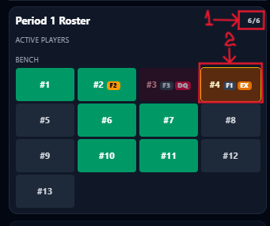

- **1** — зменшений лічильник стартового складу (наприклад, **`0/6`** або **`6/6`** замість `7`): показує, що команда має розпочати новий період у меншості через `1` невідбутий штраф із попереднього періоду;
- **2** — підсвічена бурштиновим кольором плитка гравця на лаві запасних із бейджем **`EX`**, чий штраф перенесено з попереднього періоду.

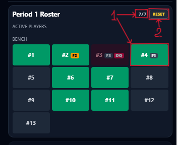

Якщо штрафний час вилученого гравця фактично завершився або він виходить у стартовому складі нового періоду:

- **1** — натисніть на підсвічену бурштинову плитку гравця з бейджем **`EX`**:
  - якщо це звичайний гравець (не дискваліфікований), перенесений штраф скасовується, необхідна кількість стартових гравців збільшується на `1` (лічильник стає **`7/7`**), а сам гравець одразу додається до стартового складу (зелена плитка);
  - якщо командний штраф (`RC18` або `RC4M`) перенесено від дискваліфікованого гравця з бейджем **`DQ`**, натискання на його підсвічену плитку скасовує найстаріший командний штраф і збільшує ліміт стартового складу до `7`, щоб ви могли обрати іншого партнера по команді (сам `DQ`-гравець у стартовий склад не додається);
- **2** — поруч із лічильником стартового складу з'являється кнопка **`Reset`**: натисніть її, якщо потрібно в один клік скасувати ручне зняття штрафів і повернути початковий стан перенесених вилучень перед стартом періоду.

---

### 7.9. Дострокове завершення та закінчення матчу

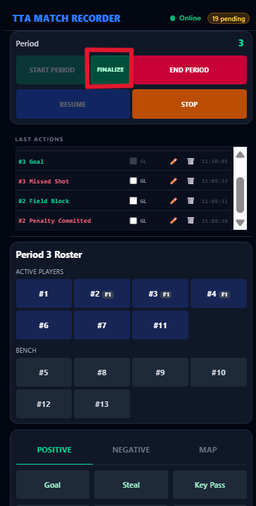

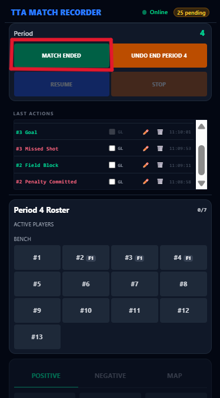

- Натискання кнопки **`FINALIZE`** у будь-який момент після старту 1-го періоду дозволяє достроково завершити матч і зафіксувати всі події, що відбулися до цього моменту.
- Натискання кнопки **`END PERIOD`** під час останнього (4-го) періоду штатно завершує ігровий час матчу та автоматично відкриває вікно оформлення підсумкового результату (`Match Result Finalization`). Якщо закрити вікно фіналізації кнопкою `Cancel`, на панелі керування періодом відображатиметься зелена кнопка **`MATCH ENDED`** (поруч із `UNDO END PERIOD 4`), натискання на яку повторно відкриває вікно фіналізації матчу.

---

### 7.10. Остаточне оформлення результату матчу (`Match Result Finalization`)

Після натискання кнопки **`FINALIZE`** або завершення останнього періоду кнопкою **`END PERIOD`** відкривається модальне вікно **`MATCH RESULT FINALIZATION`**.

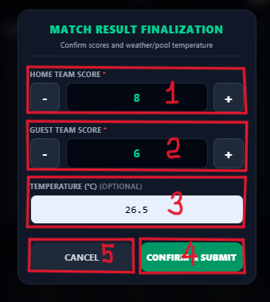

- **1** — **`Home Team Score`**: голи, забиті командою господарів (можна коригувати кнопками `-` / `+` або вручну);
- **2** — **`Guest Team Score`**: голи, забиті командою гостей (можна коригувати кнопками `-` / `+` або вручну);
- **3** — **`Temperature (°C) (Optional)`**: температура води в басейні або повітря (необов'язкове поле, наприклад `26.5`);
- **4** — кнопка **`Confirm & Submit`**: підтвердження та фінальне збереження результату матчу;
- **5** — кнопка **`Cancel`**: скасування фіналізації та повернення до консолі `TTA Match Recorder`.

> ⚠️ **УВАГА!**
> 1. **Автопідрахунок рахунку:** Початкові значення голів для обох команд розраховуються автоматично на основі всіх записаних результативних подій (`Score > 0`): позитивні результативні дії (наприклад, `Goal` / `G` або користувацькі позитивні дії зі `Score > 0`) додаються до рахунку відстежуваної команди, а негативні результативні дії (`Goal` / `GC`, `Own Goal` / `OG` або користувацькі негативні дії зі `Score > 0`) — до рахунку суперника. За потреби Користувач може відредагувати рахунок перед відправкою.
> 2. **Дострокова фіналізація:** Якщо вікно відкрито кнопкою `FINALIZE` під час активного періоду, угорі вікна з'явиться попередження: *«Period N is currently active. Finalizing will automatically end the active period and close player lineups.»*.
> 3. **Синхронізація з сервером:** Після натискання **`Confirm & Submit`** усі несинхронізовані події матчу відправляються на сервер. Це може зайняти кілька секунд, після чого автоматично відкриється підсумковий звіт матчу.

---

## 8. Отримання звітів про ТТД гравців під час матчу

### 8.1. Текстові звіти про ТТД гравців під час матчу

Після підтвердження завершення матчу у формі `Match Result Finalization` (або при натисканні кнопки **`View Report`** у розділі `My Tracked Matches`) відкривається вікно звітів **`TEAM TTA SUMMARY REPORT`**.

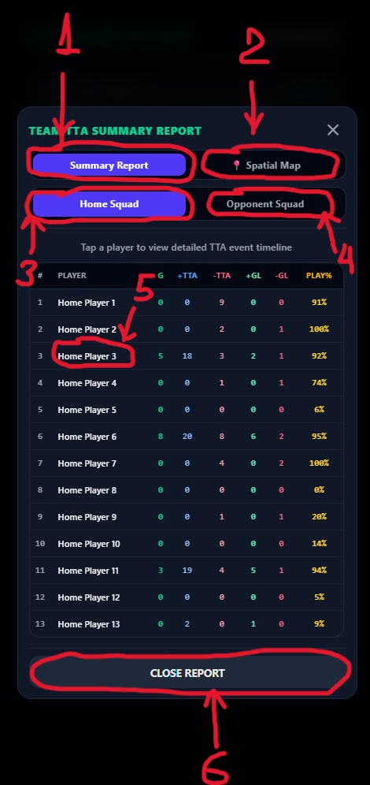

**Загальний зведений звіт команди (`Team TTA Summary Report`):**

- **1** — вкладка **`Summary Report`**: перегляд зведеної таблиці ТТД гравців команди (колонки таблиці: `#` — номер гравця, `Player` — ім'я та прізвище, `Scores` — набрані очки/голи, `+TTA` — кількість позитивних дій, `-TTA` — кількість негативних дій, `+GL` — позитивні дії, що призвели до голу, `-GL` — негативні дії, що призвели до пропущеного голу, `Play%` — відсоток ігрового часу у воді);
- **2** — вкладка **`📍 Spatial Map`**: перехід до графічної візуалізації ТТД на схемі ігрового поля та воріт;
- **3** — вкладка вибору звіту для команди господарів (`Home Team`);
- **4** — вкладка вибору звіту для команди гостей (`Guest Team`);
- **5** — натискання на ім'я конкретного гравця у таблиці (наприклад, гравця під номером `#3`) відкриває його персональний детальний звіт (`Player TTA Detailed Report`);
- **6** — кнопка **`Close Report`** (або `✕` у шапці) для закриття вікна звіту.

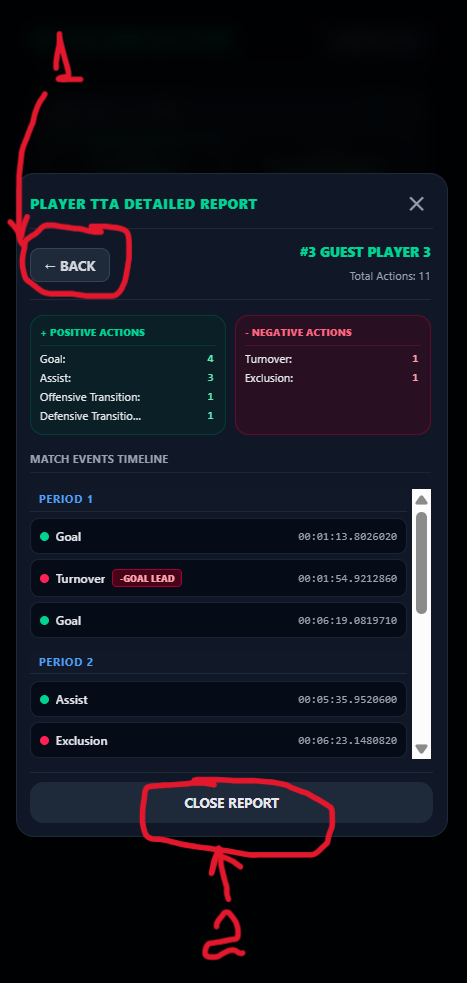

**Детальний звіт про ТТД гравця (`Player TTA Detailed Report`):**

У верхній частині звіту відображаються картки підсумкової кількості дій гравця за категоріями (**`+ Positive Actions`** та **`- Negative Actions`**), а нижче — повна хронологія подій за періодами (`Match Events Timeline`) із зазначенням нормалізованого часу матчу та бейджів **`+Goal Lead`** / **`-Goal Lead`**:

- **1** — кнопка **`← Back`** для повернення до зведеної таблиці гравців команди;
- **2** — кнопка **`Close Report`** (або `✕`) для закриття всіх звітів.

---

### 8.2. Візуалізація звіту про ТТД гравців команди з використанням схеми ігрового поля та воріт

При перемиканні у режим **`📍 Spatial Map`** заголовок вікна змінюється на **`MATCH SPATIAL ANALYTICS`**.

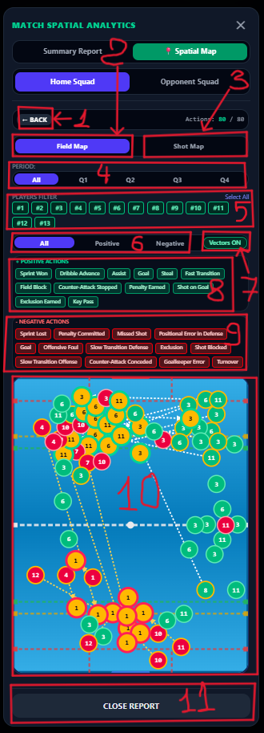

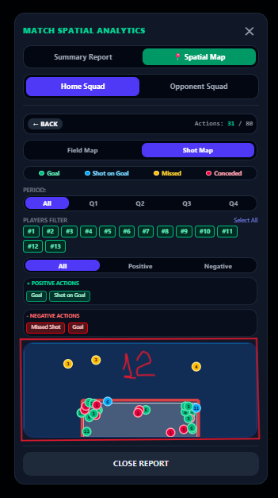

Елементи керування та фільтрації просторового звіту:

- **1** — кнопка **`← BACK`** для повернення до зведеного текстового звіту команди (`Summary Report`), поруч із якою відображається лічильник відфільтрованих подій `Actions: X / Y`;
- **2** — вкладка **`Field Map`**: відображення прив'язки ігрових подій до координат на схемі поля/басейну;
- **3** — вкладка **`Shot Map`**: відображення карти кидків у площину воріт із кольоровою легендою під перемикачем (**`Goal`** — зелений, **`Shot on Goal`** — блакитний, **`Missed`** — жовтий, **`Conceded`** — червоний);
- **4** — фільтр за періодами (**`Period: All / Q1 / Q2 / Q3 / Q4`**): вибір окремого періоду або всього матчу (`All`);
- **5** — фільтр за номерами гравців (**`Players Filter`**): вибір одного чи кількох номерів гравців (кнопка **`Select All`** праворуч вмикає всіх гравців);
- **6** — фільтр за категорією ТТД (**`All` / `Positive` / `Negative`**);
- **7** — перемикач **`Vectors ON` / `Vectors OFF`** (доступний у режимі `Field Map`): вмикає або вимикає відображення пунктирних векторів-стрілок, які з'єднують ТТД із позначкою `GL` (`Goal Lead`) із подальшим забитим або пропущеним голом;
- **8** — швидкі фільтри окремих типів позитивних ТТД (`+ Positive Actions`);
- **9** — швидкі фільтри окремих типів негативних ТТД (`- Negative Actions`);
- **10** — інтерактивна схема ігрового поля з маркерами подій (натискання або наведення на маркер відкриває спливаючу картку з деталями події: номер та ім'я гравця, назва дії, період і час; якщо подія є кидком із координатами у воротах, усередині картки доступний перемикач **`Info` / `Shot`** для перегляду міні-схеми воріт);
- **11** — кнопка **`Close Report`** (або `✕`) для закриття вікна звіту;
- **12** — інтерактивна схема воріт (`Shot Map`) із маркерами точок влучання або промахів (натискання на маркер показує гравця, період, час та тип кидка).

---

## 9. Неочікуваний збій під час відстеження матчу

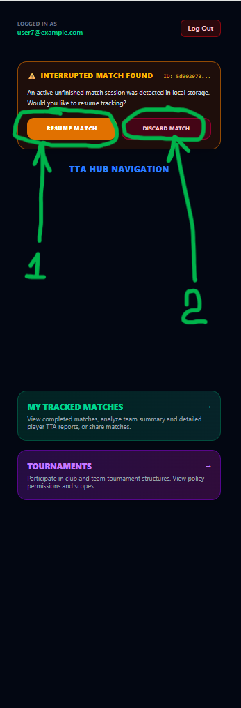

Якщо під час активного матчу додаток або браузер закрився неочікувано (або пристрій перезавантажився), усі записані дані матчу зберігаються в локальній пам'яті пристрою (IndexedDB). Після повторного відкриття додатка в головному меню з'явиться блок відновлення сесії **`⚠️ Interrupted Match Found`**:

- **1** — кнопка **`RESUME MATCH`**: відновлює відстеження перерваного матчу з того самого місця, на якому він зупинився;
- **2** — кнопка **`DISCARD MATCH`**: скасовує незавершений матч (усі локальні дані цієї чернетки буде очищено, а запис матчу — видалено з бази даних на сервері).

> ⚠️ **УВАГА!**
> Доки не буде обрано одну з двох дій — **`RESUME MATCH`** або **`DISCARD MATCH`**, — кнопка `Quick Start Match` прихована і Користувач не зможе розпочати відстеження ТТД для нового матчу.

---

## Додаток A. Позитивні ТТД (Водне поло)

За замовчуванням у додатку налаштовано **13 позитивних визначень ТТД** для водного поло:

| Абревіатура | Назва дії (Укр) | Назва дії (Eng) | Очки / Ознака кидка | Опис |
| :---: | :--- | :--- | :---: | :--- |
| **`G`** | Гол | `Goal` | `+1` гол до рахунку команди · `Shot` | Точний кидок, що завершився взяттям воріт суперника |
| **`ST`** | Перехоплення / відбір | `Steal` | `0` | Чисте відбирання або перехоплення м'яча у суперника |
| **`SP`** | Ключовий пас | `Key Pass` | `0` | Ключовий пас партнеру, що загострив атаку (необов'язково гольовий) |
| **`DA`** | Успішний дриблінг | `Dribble Advance` | `0` | Просування з м'ячем, що загострило атаку команди |
| **`SOG`** | Кидок у площину | `Shot on Goal` | `0` · `Shot` | Точний кидок у площину воріт, який відбив воротар суперника |
| **`ASV`** | Сейв | `Save` | `0` | Відбитий воротарем кидок суперника |
| **`FB`** | Блок польовим | `Field Block` | `0` | Польовий захисник заблокував політ м'яча після кидка суперника |
| **`A`** | Асист | `Assist` | `0` | Результативна передача, після якої партнер одразу забив гол |
| **`FT`** | Запуск контратаки | `Fast Transition` | `0` | Стрімкий перехід в атаку (запуск контратаки) |
| **`EE`** | Зароблене вилучення | `Exclusion Earned` | `0` | Змусив гравця суперника отримати 18-секундне вилучення |
| **`CAS`** | Зупинка контратаки | `Counter-Attack Stopped` | `0` | Своєчасне закриття (зупинка) контратаки суперника |
| **`SW`** | Виграний спринт | `Sprint Won` | `0` | Виграний стартовий заплив за м'яч на початку періоду |
| **`PE`** | Зароблений пенальті | `Penalty Earned` | `0` | Зароблений 5-метровий штрафний кидок у ворота суперника |

---

## Додаток B. Негативні ТТД (Водне поло)

За замовчуванням у додатку налаштовано **21 негативне визначення ТТД** для водного поло:

| Абревіатура | Назва дії (Укр) | Назва дії (Eng) | Очки / Дисциплінарний вплив | Опис |
| :---: | :--- | :--- | :--- | :--- |
| **`GC`** | Пропущений гол | `Goal` | `+1` гол супернику · `Shot` | Пропущений гол у власні ворота після кидка суперника |
| **`TO`** | Втрата м'яча | `Turnover` | `0` | Необґрунтована втрата володіння м'ячем гравцем команди |
| **`BP`** | Поганий пас | `Bad Pass` | `0` | Неточний пас, що призвів до втрати м'яча чи збиття темпу атаки |
| **`PEO`** | Позиційна помилка в атаці | `Positional Error in Offense` | `0` | Позиційна помилка гравця в атаці (порушення тактичної побудови) |
| **`PED`** | Позиційна помилка в захисті | `Positional Error in Defense` | `0` | Позиційна помилка в захисті (втрата зони або опікуваного гравця) |
| **`PB`** | Обіграний захисник | `Player Beaten` | `0` | Захисника обіграли 1 в 1 на дриблінгу або розвернули на позиції стовпа |
| **`OF`** | Фол в атаці | `Offensive Foul` | `0` | Відштовхування або інше порушення правил гравцем під час нападу |
| **`MS`** | Кидок повз | `Missed Shot` | `0` · `Shot` | Неточний кидок повз ворота або вище каркаса воріт |
| **`SB`** | Заблокований кидок | `Shot Blocked` | `0` | Кидок гравця, який заблокував польовий гравець суперника |
| **`GKE`** | Помилка воротаря | `Goalkeeper Error` | `0` | Невдала дія воротаря (втрата позиції, неприкритий ближній кут тощо) |
| **`E`** | Вилучення | `Exclusion` | Персональний фол (`+1 F`) · Вилучення на **18 с** (`EX`) + авто-вихід на `Bench` (3-й фол → `DQ`) | Отримане 18-секундне вилучення (гравець залишає воду; після 18 с він або партнер може повернутися через `Shorthanded`) |
| **`STO`** | Затримав контратаку | `Slow Transition Offense` | `0` | Повільний перехід в атаку (затягування розвитку атаки, втрата темпу) |
| **`STD`** | Не повернувся в захист | `Slow Transition Defense` | `0` | Повільний перехід у захист (гравець вчасно не повернувся в оборону) |
| **`CAC`** | Обрізався | `Counter-Attack Conceded` | `0` | Допущена контратака суперника через обрізку або втрату м'яча |
| **`BU`** | М'яч під водою | `Ball Under` | `0` | Порушення правил: гравець сховав м'яч від захисника під воду |
| **`SL`** | Програний спринт | `Sprint Lost` | `0` | Програний стартовий заплив за м'яч на початку періоду |
| **`PC`** | Привезений пенальті | `Penalty Committed` | Персональний фол (`+1 F`) без тимчасового вилучення (3-й фол → `DQ` + авто-вихід на `Bench`) | Порушення правил, що призвело до призначення 5-метрового пенальті у власні ворота |
| **`RC18`** | Червона картка (18 с) | `Red Card (18s)` | Дискваліфікація гравця до кінця матчу (`DQ`) + авто-вихід на `Bench` · Командний штраф **18 с** (`EX`) | Вилучення гравця до кінця гри з правом виходу іншого гравця з лави запасних після 18 секунд гри в меншості |
| **`RC4M`** | Червона картка (4 хв) | `Red Card (4 Min)` | Дискваліфікація гравця до кінця матчу (`DQ`) + авто-вихід на `Bench` · Командний штраф **4 хв / 240 с** (`EX`) | Вилучення гравця до кінця гри з правом виходу іншого гравця з лави запасних після 4 хвилин (240 с) гри в меншості |
| **`RCP`** | Червона картка (пенальті) | `Red Card (Penalty)` | Дискваліфікація гравця до кінця матчу (`DQ`) + авто-вихід на `Bench` · Без таймера командного штрафу | Вилучення гравця до кінця гри з призначенням пенальті; інший гравець із лави запасних може вийти у воду через `Shorthanded` без очікування штрафного часу |
| **`OG`** | Автогол | `Own Goal` | `+1` гол супернику · `Shot` | Гол, забитий у власні ворота |
